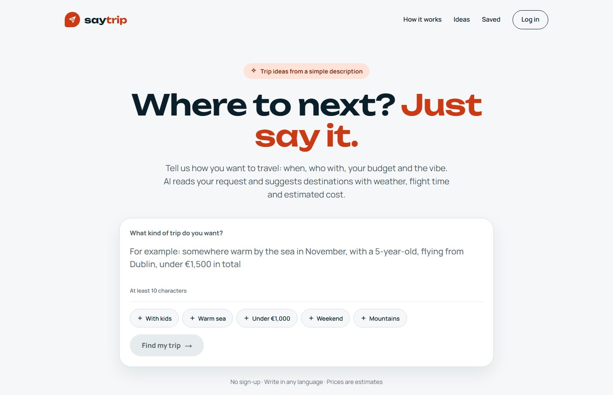
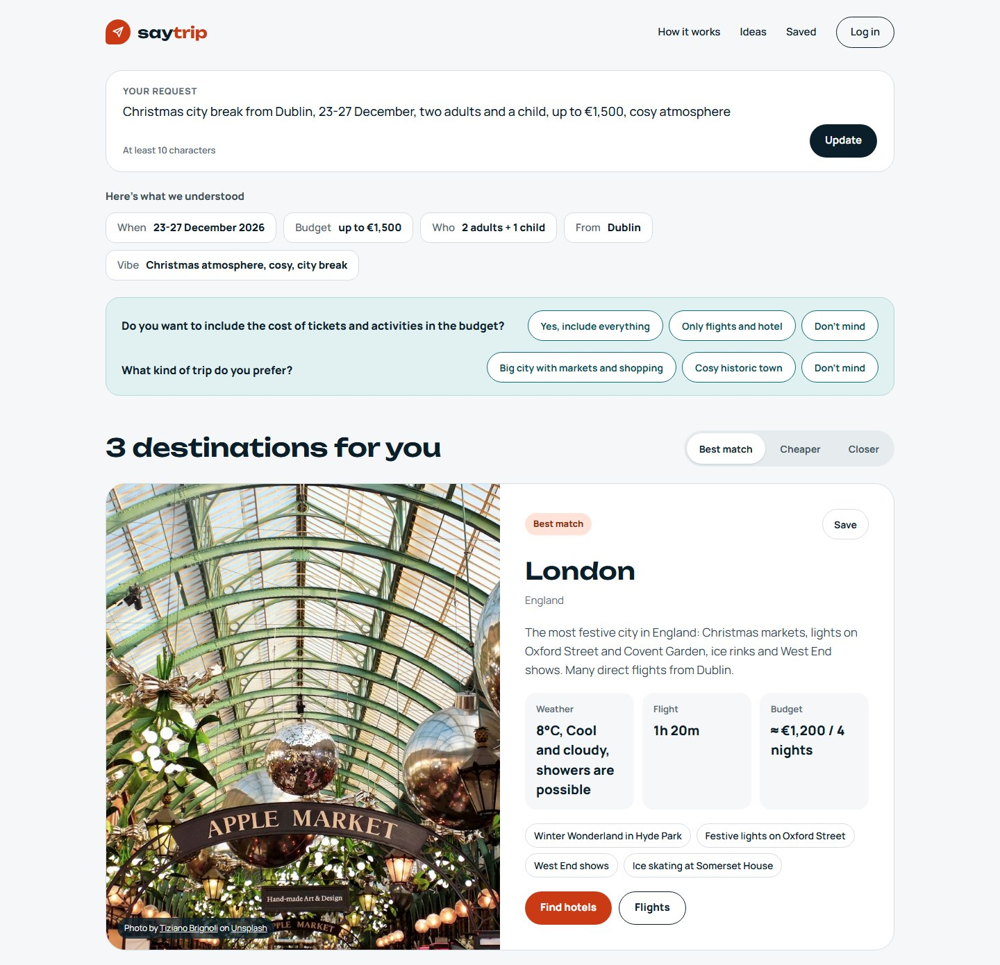

# Saytrip

Describe a trip in your own words and get destination ideas that fit it.

Type something like *"Christmas city break from Dublin, two adults and a child, up to €1,500"*. An AI model reads the request, works out the dates, budget, group and departure city, and suggests three destinations with weather, flight time, estimated cost and links to search hotels and flights.

> Work in progress. The core flow works end to end; see [Status](#status) for what is next.





## Features

- **Free-form search.** One text field, any language. The model returns structured data (validated with Zod on the server), not free text.
- **"Here's what we understood".** Parsed dates, budget, travellers, departure city and vibe are shown as chips, so the user can see how the request was read.
- **Clarifying questions.** If something important is missing, the model asks a short question with answer options; the answer is appended to the request.
- **Destination cards.** Why it fits, weather, flight time, estimated budget, highlights, a photo from Unsplash, and links to Booking and Skyscanner. Results can be sorted by best match, price or distance.
- **Accounts.** Sign up and log in with email and password (bcrypt, JWT in an `httpOnly` cookie).
- **Subscriptions.** Paid plans through Stripe Checkout (test mode), with a signed webhook keeping the subscription in the database in sync with Stripe.
- **Rate limits.** Per IP for search and sign-up, per IP and email for login, per user for checkout.

## Tech stack

| Part | Stack |
|---|---|
| Client | Next.js 16 (App Router), React 19, TypeScript, SCSS Modules, React Hook Form, Zod |
| Server | NestJS 12, TypeScript, Zod, `@nestjs/throttler`, helmet |
| Database | PostgreSQL, Prisma 7 |
| AI | Anthropic API (Claude), structured output |
| Payments | Stripe (Checkout, webhooks) |
| Photos | Unsplash API |

## How it works

```
Browser ──> Next.js (server components) ──> NestJS API ──> Anthropic API
                                               │
                                               ├──> Unsplash (photos)
                                               ├──> PostgreSQL (users, subscriptions)
                                               └──< Stripe webhooks
```

1. The user submits a request; the results page calls `POST /api/suggestions`.
2. The server sends the request to the model with a JSON schema and validates the response.
3. Each destination is enriched with a photo and partner links, then rendered by the client.

## Project structure

```
client/   Next.js app
server/   NestJS API, Prisma schema and migrations
docs/     screenshots
```

## Getting started

Requirements: Node.js 22+, PostgreSQL.

**Server**

```bash
cd server
npm install
cp .env.example .env          # fill in DATABASE_URL, SESSION_SECRET and Stripe test keys
npx prisma migrate deploy --config prisma7.config.ts
npx prisma generate --config prisma7.config.ts
npm run start:dev             # http://localhost:5000/api
```

`AI_MOCK=full` in `.env` returns a sample response, so the app runs without an Anthropic key. Remove it and set `ANTHROPIC_API_KEY` to call the real model.

For subscriptions, forward Stripe events with the [Stripe CLI](https://docs.stripe.com/stripe-cli):

```bash
stripe listen --events customer.subscription.created,customer.subscription.updated,customer.subscription.deleted --forward-to localhost:5000/api/billing/webhook
```

**Client**

```bash
cd client
npm install
cp .env.example .env
npm run dev                   # http://localhost:3000
```

## Status

Done: search with AI, results page, clarifying questions, sign up and log in, account page, Stripe subscriptions in test mode, rate limits.

Next:
- choose the model and reasoning effort by subscription plan, and daily search quotas;
- plan changes and cancellation through the Stripe Customer Portal;
- responsive layout for mobile;
- saved trips;
- day-by-day trip plan for a chosen destination.
